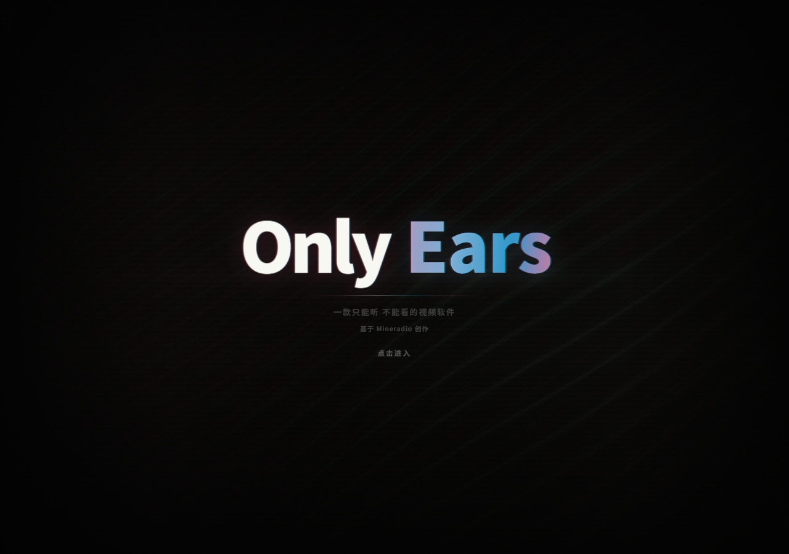
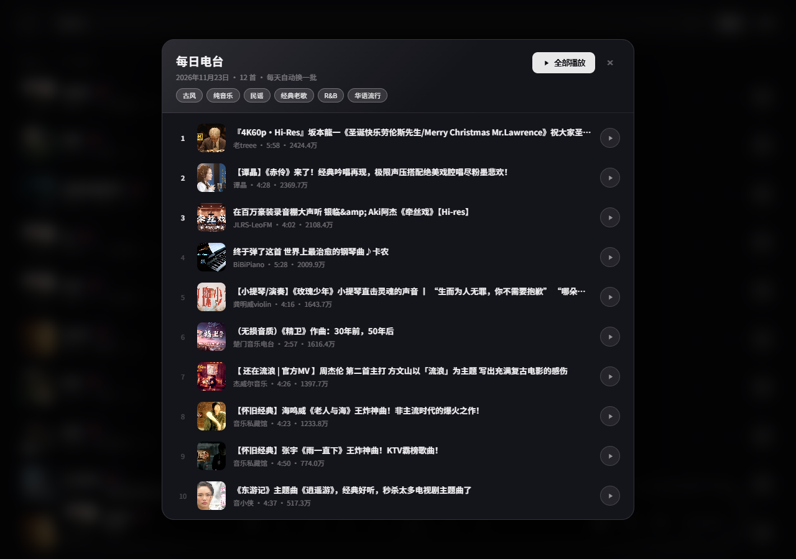

<div align="center">

# OnlyEars

**一款只能听 不能看的视频软件**

*A music player that only listens, never watches.*

[](LICENSE)
[](https://github.com/XxHuberrr/Mineradio-paused)
[]()
[](../../releases)

[下载](#下载) · [功能详解](#功能详解) · [截图](#截图) · [常见问题](#常见问题) · [更新日志](CHANGELOG.md) · [反馈](#反馈)

</div>

---

## 这是什么

从 Bilibili 获取音源的音乐播放器。

在 B站 上千个视频里精准匹配到你要的那首歌，只取音频流，从不播放画面。

界面、歌词舞台、粒子视觉来自 [Mineradio](https://github.com/XxHuberrr/Mineradio-paused)（GPL-3.0），
音源匹配与播放逻辑为本项目重写。

---

## 为什么是「只能听」

B站 上有海量的官方 MV、Hi-Res 音质、录音室播放视频。这些资源的音质不比音乐平台差，
问题是它们都是**视频**。

OnlyEars 做的事：

```
搜索「发如雪 周杰伦」
  ↓
找到 33 个 B站 视频（4K修复版、Hi-Res 版、录音棚版、动态鼓谱…）
  ↓
按时长/标题/播放量打分，选出最可能是原曲的那个
  ↓
解析 DASH 音轨，只取音频流
  ↓
播放。全程不加载任何画面。
```

**省下的是：**

- 视频带宽（1080p 比音频大 10 倍以上）
- 显卡解码开销
- 内存占用

---

## 截图

<div align="center">

### 启动页



### 找音源 —— 核心功能

点击搜索结果，会列出 B站 上所有匹配的视频，**每个都带评分和匹配依据**：


### 每日电台

按日期生成，同一天固定，每天自动换一批：



### 超极简模式

只有歌词，背景纯黑。适合低配机器或省电：


</div>

---

## 功能详解

### 一、搜索

两种模式，作用完全不同。

#### 精确模式（默认，推荐）

按「歌名 + 歌手」搜索，然后**逐个候选视频打分**：

**打分规则**（总分越大越可能是原曲）：

| 维度 | 判断 | 加减分 |
|---|---|---|
| **时长** | 与目标差 ≤1.5% | **+50** |
| | 差 ≤5% | +30 |
| | 差 ≤12%（可能是 MV 版） | +10 |
| | 差 >25%（可能是剪辑/片段） | −40 |
| **标题关键词** | 含「官方 / MV / 无损 / Hi-Res / 歌词」 | **+12** |
| | 含「翻唱 / 伴奏 / 鬼畜 / 合集 / live」 | **−40** |
| **分区** | MV 区（tid=193） | +25 |
| | 音乐区（tid=3） | +8 |
| | 非音乐区 | −20 |
| **播放量** | >100 万 | +6 |
| **变速版本** | 0.9x / 0.95x / 1.05x / 1.1x / 1.25x | +15 |
| **时长异常** | >目标 1.6 倍 或 <0.55 倍 | −60 |

**最终得分最高的排第一。**

#### 模糊模式

直接调 B站 搜索接口，不走打分。速度快，但结果杂。

**什么时候用模糊模式**：

- 精确模式搜不到（歌名有错别字、冷门歌）
- 想快速看 B站 上都有什么

---

### 二、找音源

点搜索结果里的任意一首，进入这个页面。

**显示什么**：

```
【4K修复】周杰伦 - 发如雪 MV
zyl2012_音乐无限 · 5:02 · 655.5万 · Δ+3s
┌─────────┬───────┬───────┐
│ 时长精确 │ 白名单 │ 高播放 │        68 分
└─────────┴───────┴───────┘
```

- **Δ+3s** —— 与目标时长差 3 秒
- **时长精确 / 白名单 / 高播放** —— 得分理由标签
- **68 分** —— 综合得分（绿色=高，橙色=中，灰色=低）

**能做什么**：

- 点任意一首播放
- 点右侧下载按钮单独下载
- 顶部分P按钮（如果该视频是多P）

**为什么要手动选**：

打分算法是启发式的，会有判断错的情况。比如：

- 某首歌的「官方 MV」版本反而音质差
- 某首 Hi-Res 版本是二创的调音版

这时手动切一下就行。

---

### 三、每日电台

首页点「每日电台」。

**生成逻辑**：

```
用今天的日期做随机种子
  ↓
从 20 个关键词池里抽 6 个
  （华语流行 / 欧美流行 / 粤语歌 / 日语歌 / 纯音乐 /
    钢琴曲 / 民谣 / 摇滚 / 说唱 / R&B / 古风 /
    电子音乐 / 爵士 / 乡村音乐 / 经典老歌 /
    90年代金曲 / 00年代金曲 / 影视原声 / 动漫音乐 / 韩语歌）
  ↓
每个关键词搜一次，按播放量排序
  ↓
过滤：
  · 时长必须在 90-480 秒
  · 排除跳舞 / 片段 / 剪辑 / 盘点 / 解说 / 鬼畜 / 整活
  · 标题必须含官方 / MV / Hi-Res / 无损 / 专辑 / 主题曲等
  · 多P视频跳过（通常是合集）
  · 同一个 UP 主最多 2 首
  ↓
去重，按播放量排序，取前 30 首
```

**同一天结果是固定的**（种子不变），跨天自动换。

**自动续播**：

播到倒数第 2 首时，自动请求下一批（用「日期 + 1」做种子），
排除已播过的视频，追加到队列末尾。

**所以理论上可以一直听下去**，不用管。

---

### 四、历史播放

首页点「历史播放」或队列里切播放来源。

**同曲去重**：

播了 3 个不同版本的「发如雪」（4K版、Hi-Res版、鼓谱版），
历史里**只显示 1 条**，展开能看到 3 个版本：

```
发如雪                    周杰伦 · 4:59 · 播 3 次
  ▼
  ● 【4K修复】发如雪        UP1 · 播 2 次 · 匹配 68   [默认]
    【Hi-Res】发如雪        UP2 · 播 1 次 · 匹配 62   [设为默认]
    发如雪 动态鼓谱         UP3 · 播 1 次 · 匹配 50   [设为默认]
```

**去重规则**：

歌名 + 歌手，去掉括号内容后比对：

```
发如雪           → 发如雪|周杰伦
发如雪 (Live)    → 发如雪|周杰伦   ← 合并
【4K修复】发如雪  → 发如雪|周杰伦   ← 合并
发如雪（伴奏）    → 发如雪|周杰伦   ← 合并
```

**什么算一次播放**：

连续播放满 **10 秒**才计入（避免点错了也算）。

**能做什么**：

- 点行 → 用默认音源播放，整段历史成为播放上下文
- 展开 → 看到所有版本，可设默认
- 右键 → 从历史移除
- 顶部「清理全部」

---

### 五、下载

**两种格式**：

| 格式 | 说明 | 大小参考（5 分钟歌曲） |
|---|---|---|
| **m4a** | 原音质直存，不转码 | 8-10 MB |
| **mp3** | 转成 192kbps mp3 | 6-7 MB |

**m4a 是无损的吗**：

取决于 B站 原视频的音质。B站 最高提供 192k 的 AAC 音轨，
部分 Hi-Res 视频能到 320k。**不是真无损**，但也不做二次压缩。

**单曲下载**：

搜索结果 / 找音源页 / 播放条上都有下载按钮。

**批量下载**：

- 歌单详情页顶部「下载整个歌单」
- 会先弹设置框（目录 + 格式），确认后开始
- 队列面板显示进度，可取消

**下载管理**（首页卡片）：

- 列出所有已下载的文件
- 支持勾选多个，批量「播放 / 移除 / 删除文件」
- 「仅从列表移除」= 不删文件
- 「连同文件删除」= 真的删磁盘上的文件
- 删除时会同步清理歌单里的引用

**文件命名**：

```
歌手 - 歌名.m4a
```

重名会自动加 `(2)`、`(3)`。

**下载完会自动加入本地曲库**，在「本地和下载」播放来源里能看到。

---

### 六、我的歌单

**新建**：

- 队列面板「+ 新建歌单」
- 或搜索结果里「加入歌单」→「新建」

**加入歌曲**：

- 搜索结果每行右侧「+」按钮
- 找音源页右上角「加入歌单」
- 历史播放右键
- 分P面板「整单创建歌单」

**播放歌单**：

点歌单 → 详情页 → 点任意一首。
**整张歌单会写进播放队列**，所以顺序播、随机播、单曲循环全都正常。

**下载整个歌单**：

详情页顶部「全部下载」，会先问你目录和格式。

---

### 七、极简模式（性能）

设置面板（右上角齿轮）**顶部第一个卡片**。

点击在三档之间循环切换：

| 档位 | 关闭了什么 | 实测数据 |
|---|---|---|
| **标准** | 什么都不关，特效全开 | 119 fps / 238 个毛玻璃滤镜 / 9 个动画 |
| **极简** | 粒子、3D 歌词、毛玻璃、所有滤镜 | 27 fps / 0 滤镜 / 0 动画 |
| **超极简** | 上面全部 + 封面粒子 + 背景渐变 | 12 fps / 0 滤镜 / 0 动画 |

**三档都保留歌词。**

**具体关掉的东西**：

```
标准 → 极简
  · 背景星河粒子
  · 电影镜头运动（画面轻微晃动）
  · 浮动层 / 边缘光 / 景深 / 泛光
  · 歌词发光 / 节拍发光 / 歌词粒子
  · 歌词垂直浮动
  · 实时音频监测（这个吃 CPU 最多）
  · 声波浮动
  · 手势覆盖层
  · 全站 backdrop-filter（GPU 负载的大头）
  · 所有过渡动画

极简 → 超极简
  · 封面粒子化（3 个 33489 顶点的 Points 对象全部 drawRange 归零）
  · 所有背景渐变（纯黑）
  · 所有阴影
```

**设置保存到 localStorage，重启后保持。**

**退出极简模式后原设置完整恢复**——只改运行时值，不动 Mineradio 原本的配置。

---

### 八、其他

**播放来源切换**（队列面板顶部按钮）：

```
当前队列      手动排的歌
每日电台      今天的电台列表
历史播放      听过的歌
本地和下载    本地曲库中的所有文件
我的歌单      各个歌单
```

切换后**整段列表写进播放队列**，所以循环/随机/单曲都正常。

---

## 下载

### 主渠道：GitHub Releases

**从 [Releases](../../releases) 页面下载。**

| 文件 | 大小 | 说明 |
|---|---|---|
| `OnlyEars-Setup-x.x.x.exe` | ~104 MB | 安装包 |
| `OnlyEars-Portable-x.x.x.zip` | ~147 MB | 便携版 |

**安装版会装到** `%LOCALAPPDATA%\Programs\OnlyEars`，不需要管理员权限。

**系统要求**：Windows 10 及以上（64 位）

> ⚠️ **不要解压到 `C:\Program Files`**
>
> 那里需要管理员权限，Electron 写入缓存会失败，表现为启动后白屏或功能异常。

---

## 快捷键

| 键 | 功能 |
|---|---|
| `空格` | 播放 / 暂停 |
| `←` `→` | 快退 / 快进 10 秒 |
| `↑` `↓` | 音量 |
| `Esc` | 关闭当前面板 |
| `Ctrl+Alt+D` | 诊断信息（排查问题用） |

---

## 数据位置

| 类型 | 路径 |
|---|---|
| 播放历史 | `程序目录\resources\app\data\play-history.json` |
| 本地歌单 | `程序目录\resources\app\data\local-playlists.json` |
| 下载设置 | `程序目录\resources\app\data\download-settings.json` |
| 缓存 / 窗口状态 | `%APPDATA%\Mineradio\` |
| 下载的音频 | 默认 `%USERPROFILE%\Music\Mineradio\`（可改） |

**想恢复全新状态**：删掉 `data` 目录和 `%APPDATA%\Mineradio`。

> 目录名仍是 `Mineradio`，这是为了兼容已有数据。改掉会让历史记录和歌单丢失。

---

## 常见问题

<details>
<summary><b>启动后黑屏 / 白屏</b></summary>

**原因**：前一次进程没完全退出，端口 3000 被占用。

**解决**：任务管理器结束所有 `Mineradio.exe` 和 `node.exe`，再重新打开。

</details>

<details>
<summary><b>启动页卡在「点击进入」</b></summary>

那就是设计如此——点一下屏幕才进主界面。

如果点了没反应，先看任务管理器里进程是否还在。

</details>

<details>
<summary><b>搜到了但播不出来</b></summary>

**原因**：B站 那个视频可能已被删除、设为私密、或限制地区播放。

**解决**：在「找音源」页换一个候选。通常 33 个候选里总有能播的。

</details>

<details>
<summary><b>搜索结果不准，第一首不是原曲</b></summary>

试试：

1. 加上歌手名：`发如雪 周杰伦` 而不是 `发如雪`
2. 切到「模糊」模式
3. 只搜歌名，不要带专辑名或多余的字

还不行就去「找音源」页手动选。

</details>

<details>
<summary><b>下载很慢</b></summary>

速度取决于 B站 CDN，跟你的网络到 B站 的距离有关。

批量下载可以取消后重来，**已下完的不会重复下**。

</details>

<details>
<summary><b>歌词不显示</b></summary>

**原因**：有些 B站 视频没有歌词，或歌词在视频画面里（不是字幕轨）。

**解决**：在「找音源」页换一个候选，标题带「歌词版」「动态歌词」的通常有。

</details>

<details>
<summary><b>界面很卡 / 风扇狂转</b></summary>

设置里开「极简模式」，直接从「标准」切到「超极简」。

会关掉所有粒子、毛玻璃和 3D 效果，只保留歌词和界面。

实测 238 个毛玻璃滤镜归零，GPU 负载降 80% 以上。

</details>

<details>
<summary><b>能改下载目录吗</b></summary>

可以，三个地方都能改：

1. 首页「下载设置」卡片
2. 下载确认框里的「保存到」
3. 下载管理面板的「设置」标签

</details>

<details>
<summary><b>下载的文件在哪</b></summary>

默认 `%USERPROFILE%\Music\Mineradio`。

不记得改过没有的话，首页「下载设置」能看到当前路径，也可以点「打开文件夹」。

</details>

<details>
<summary><b>个别歌曲时长不对</b></summary>

B站 有些视频是加速/减速版（0.9x、1.1x），打分算法会识别并降权，
但仍有可能选错。手动去「找音源」页挑一个时长接近的即可。

</details>

---

## 从源码运行

需要 Node.js 20+。

```bash
# 安装依赖
npm install

# 启动后端（浏览器访问 http://127.0.0.1:3000）
node server.js
```

**完整桌面版**需要 Electron，`desktop/main.js` 是主进程入口。

> ⚠️ 纯 `node server.js` 只能跑后端 + 网页界面。
>
> 部分功能依赖 Electron API，在浏览器模式下不可用：
> - 本地文件播放（自定义协议）
> - 下载目录选择对话框
> - 窗口控制

---

## 反馈

**QQ 群：418363567**

软件内首页「意见反馈」卡片里也能看到，可一键复制群号。

**报问题时请带上**：

1. 具体做了什么操作
2. 什么歌/什么搜索结果
3. 截图
4. 版本号（反馈面板底部能看到）

---

## 致谢

本项目的界面框架、歌词渲染引擎、粒子系统、视觉控制台、Electron 主进程结构
全部来自 **Mineradio**，由 [XxHuberrr](https://github.com/XxHuberrr/Mineradio-paused)
开发，以 GPL-3.0 协议开源。

没有 Mineradio，就没有这个项目。

**OnlyEars 重写的部分**：

- Bilibili API 接入层（wbi 签名、DASH 取流、歌词、评论）
- 音源匹配算法（多维打分）
- 下载引擎（m4a 直存 / mp3 转码）
- 本地歌单与播放历史（同曲去重）
- 每日电台（日期种子、内容过滤、自动续播）
- 极简模式（三档性能切换）
- 意见反馈面板

**完整第三方声明见 [NOTICE.md](NOTICE.md)。**

---

## 免责声明

**本项目仅供个人学习与技术研究使用。**

- 所有音频内容来自 **Bilibili 平台的公开视频**，版权归原视频上传者所有
- 本程序不存储、不缓存、不重新分发任何音视频内容
- 本程序不绕过任何付费、会员或 DRM 保护机制
- 下载功能仅用于缓存用户本就有权访问的内容，请勿用于二次传播

**用户应自行遵守**：

- Bilibili 的用户协议与版权规则
- 所在地区的著作权法律法规

**本项目与 Bilibili 无任何关联**，未获其授权或认可。

因使用本程序产生的一切后果（包括但不限于版权纠纷、账号封禁）由使用者自行承担。

---

## 许可证

[GPL-3.0](LICENSE)

本项目继承 Mineradio 的许可证。

**分发二进制（EXE/ZIP）时必须同时提供完整源码。**

---

<div align="center">

**OnlyEars** · 一款只能听 不能看的视频软件

QQ 群 418363567

</div>
