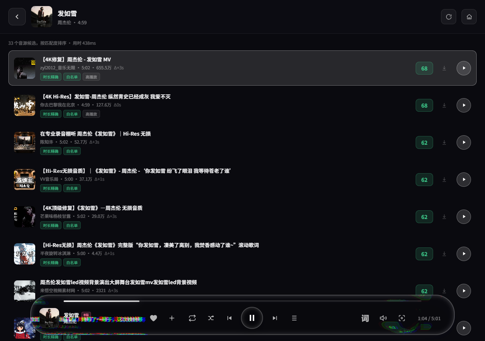
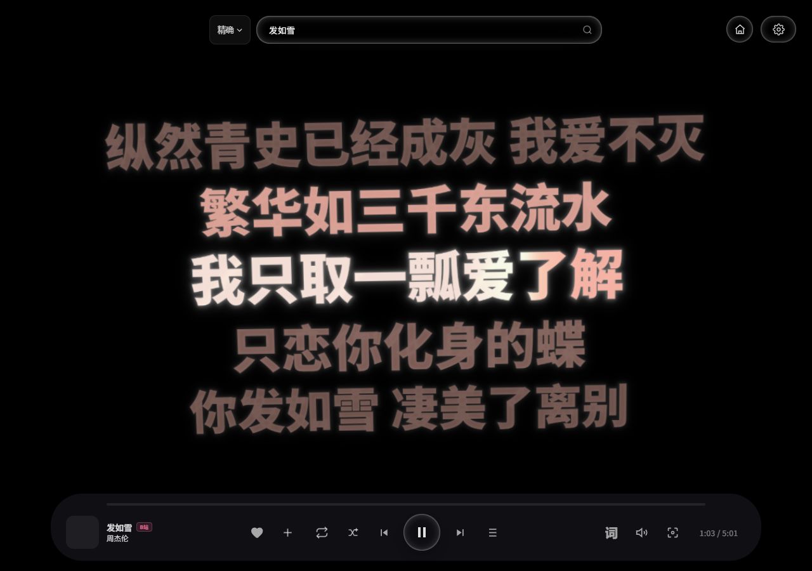

<div align="center">

# OnlyEars

**一款只能听 不能看的视频软件**

*A music player that only listens, never watches.*

[](LICENSE)
[](https://github.com/XxHuberrr/Mineradio)
[]()

[功能](#功能) · [下载](#下载) · [截图](#截图) · [常见问题](#常见问题) · [反馈](#反馈)

</div>

---

从 Bilibili 获取音源的音乐播放器。

在 B站 上千个视频里精准匹配到你要的那首歌，只取音频，从不播放画面。

界面、歌词舞台、粒子视觉来自 [Mineradio](https://github.com/XxHuberrr/Mineradio)（GPL-3.0），音源与播放逻辑为本项目重写。

---

## 为什么是「只能听」

B站 上有海量的官方 MV、Hi-Res 音质、录音室播放。这些资源音质不比音乐平台差，但它们是**视频**。

OnlyEars 做的事：找到那个视频 → 只抽取音轨 → 播放。

**不加载画面，不浪费带宽，不占显存。**

---

## 截图

<div align="center">

### 启动页


### 搜索与找音源

点击搜索结果，会列出 B站 上所有匹配的视频，按匹配度打分：



### 每日电台

按日期生成，同一天固定，每天自动换一批：


### 超极简模式

只有歌词，背景纯黑。适合低配机器或省电：



</div>

---

## 功能

### 搜索

- **精确模式** —— 按歌名 + 歌手匹配，逐个候选比对时长、标题关键词、播放量打分
- **模糊模式** —— 直接搜 B站，速度快但结果杂
- 支持分页浏览

### 找音源

点搜到的歌会进入候选列表，每个 B站 视频都会显示：

```
【4K修复】周杰伦 - 发如雪 MV
zyl2012_音乐无限 · 5:02 · 655.5万 · Δ+3s
时长精确  白名单  高播放                    68 分
```

- 时长偏差（Δ）
- 匹配标签（时长精确 / 白名单关键词 / 高播放）
- 综合评分
- 可手动选择任意版本播放

### 每日电台

- 按日期做种子，同一天结果固定，跨天自动换
- 已过滤：短视频、合集、多 P、非音乐内容
- 听完自动续下一批（播到倒数第 2 首时触发）

### 历史播放

- 同一首歌的多个 B站 版本**自动合并成一条**
- 点开能看到所有播过的版本，可设默认
- 播满 10 秒才计入（避免误记）

### 下载

- **m4a** 原音质直存 / **mp3** 192k 转码
- 批量下载歌单，带进度和取消
- 下载管理支持批量选择、删除
- 下载完成的文件自动加入本地曲库

### 我的歌单

- 新建、重命名、删除
- 从搜索 / 电台 / 历史加入
- 整张歌单一起播放或一起下载

### 极简模式

设置面板顶部，三档切换：

| 档位 | 效果 |
|:---:|---|
| **标准** | 粒子封面、毛玻璃面板、3D 歌词 |
| **极简** | 关粒子 / 3D / 毛玻璃，界面改实色 |
| **超极简** | 纯黑背景，**只留歌词** |

三档都保留歌词。

<details>
<summary>性能对比（实测）</summary>

| 指标 | 标准 | 极简 | 超极简 |
|---|---|---|---|
| CSS 滤镜 / 毛玻璃 | 238 个 | 0 | 0 |
| 渲染画布 | 5 个 | 0 | 0 |
| CSS 动画 | 9 个 | 0 | 0 |
| 帧率 | 119 fps | 27 fps | 12 fps |

</details>

---

## 下载

**从 [Releases](../../releases) 页面下载。**

| 文件 | 说明 |
|---|---|
| `OnlyEars-Setup-x.x.x.exe` | 安装包，装到 `%LOCALAPPDATA%\Programs\OnlyEars`，不需要管理员权限 |
| `OnlyEars-Portable-x.x.x.zip` | 便携版，解压即用 |

**系统要求**：Windows 10 及以上（64 位）

> **不要解压到 `C:\Program Files`** —— 那里需要管理员权限，Electron 写入缓存会失败。

---

## 快捷键

| 键 | 功能 |
|---|---|
| `空格` | 播放 / 暂停 |
| `←` `→` | 快退 / 快进 |
| `↑` `↓` | 音量 |
| `Esc` | 关闭当前面板 |
| `Ctrl+Alt+D` | 诊断信息 |

---

## 数据位置

| 类型 | 路径 |
|---|---|
| 播放历史 / 歌单 / 下载设置 | `程序目录\resources\app\data\` |
| 缓存 / 窗口状态 | `%APPDATA%\Mineradio\` |

> 目录名仍是 `Mineradio`，这是为了兼容已有数据。改掉会让历史记录和歌单丢失。

---

## 常见问题

<details>
<summary><b>启动后黑屏 / 白屏</b></summary>

任务管理器结束所有 `Mineradio.exe` 和 `node.exe`，再重新打开。

偶尔是前一次没有完全退出，端口被占用。
</details>

<details>
<summary><b>搜到了但播不出来</b></summary>

B站 的视频可能已被删除或限制播放。

重新搜索，或者在「找音源」页换一个候选。
</details>

<details>
<summary><b>搜索结果不准</b></summary>

试试：

1. 加上歌手名（`周杰伦 发如雪`）
2. 切到「模糊」模式
3. 只搜歌名，不要搜专辑名
</details>

<details>
<summary><b>下载很慢</b></summary>

速度取决于 B站 CDN，跟网络环境有关。

批量下载可以取消后重来，已完成的不会重复下。
</details>

<details>
<summary><b>歌词不显示</b></summary>

有些 B站 视频没有歌词。

换一个有歌词的版本（在「找音源」页换候选）。
</details>

<details>
<summary><b>界面很卡</b></summary>

设置里开「极简模式」，特别是「超极简」档。

会关掉所有粒子、毛玻璃和 3D 效果，只保留歌词和界面。
</details>

<details>
<summary><b>能改下载目录吗</b></summary>

可以。首页「下载设置」里改，或者下载确认框里直接改。
</details>

---

## 从源码运行

需要 Node.js 20+。

```bash
# 安装依赖
npm install

# 启动后端（浏览器访问 http://127.0.0.1:3000）
node server.js
```

**完整桌面版**需要 Electron，`desktop/main.js` 是主进程入口。

> 注意：`node server.js` 只能跑后端 + 网页界面，部分功能（本地文件播放、下载目录选择）依赖 Electron API，在纯浏览器模式下不可用。

---

## 反馈

**QQ 群：418363567**

软件内首页「意见反馈」卡片里也能看到，可一键复制群号。

加群后直接说遇到的问题，带上截图会快很多。

---

## 致谢

本项目的界面框架、歌词渲染、粒子系统、视觉控制台全部来自 **Mineradio**，由 [XxHuberrr](https://github.com/XxHuberrr) 开发，以 GPL-3.0 协议开源。

没有 Mineradio，就没有这个项目。

**本项目重写的部分**：

- B站 API 接入（wbi 签名、候选打分、DASH 取流）
- 音源匹配算法
- 下载引擎
- 本地歌单 / 播放历史
- 每日电台
- 极简模式

---

## 许可证

[GPL-3.0](LICENSE)

本项目继承 Mineradio 的许可证。分发二进制时必须同时提供源码。

---

<div align="center">

**OnlyEars** · 一款只能听 不能看的视频软件

</div>
